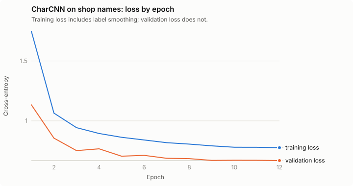

# Deep learning for the category models

Generated by `python -m sugo_category.deep_report` on 2026-09-25. The architecture and training practice are described in `sugo_category/deep.py`; the data cleansing that came first is in [CLEANSING.md](CLEANSING.md).

## Shop names (the store model)

Scored on the held-out OpenStreetMap test names, which no model trained on.

| Model | Accuracy | Log loss |
|---|---:|---:|
| TF-IDF logistic regression | 82.7% | 0.5171 |
| CharCNN | 77.6% | 0.6559 |
| Ensemble, linear weight 0.8 (calibrated) | 83.0% | 0.5031 |

Calibrated ensemble: 85.3% of names get a category, 89.6% of those right; 69.8% auto-accepted, 94.8% right. Production's own labelled shops: 9 of 9 right.

## Items (the item model)

Scored on `data/item_benchmark.csv`: items a person labelled that appear in no seed list, so the
only test of whether a model generalises rather than recalls.

| Model | Benchmark accuracy | Bakery items right | Log loss |
|---|---:|---:|---:|
| logistic | 70.8% | 75.0% | 0.7898 |
| charcnn (from scratch) | 31.2% | 37.5% | 1.6894 |
| charcnn (transferred from the store network) | 56.2% | 62.5% | 1.093 |
| ensemble (logistic + transferred charcnn), linear weight 0.8 | 72.9% | 75.0% | 0.7449 |

What each answers for items customers actually order:

| Item | logistic | charcnn (from scratch) | charcnn (transferred from the store network) | ensemble (logistic + transferred charcnn) |
|---|---|---|---|---|
| Pandesal | Bakery 1.00 | Bakery 0.92 | Bakery 0.97 | Bakery 1.00 |
| Spanish bread | Bakery 1.00 | Bakery 0.60 | Bakery 0.96 | Bakery 1.00 |
| Ensaymada | Bakery 0.92 | Fast Food & Restaurant 0.27 | Supermarket & Grocery 0.26 | Bakery 0.93 |
| Monay | Bakery 0.87 | Supermarket & Grocery 0.26 | Convenience Store 0.51 | Bakery 0.87 |
| Pan de coco | Bakery 0.95 | Retail & General Merchandise 0.22 | Bakery 0.81 | Bakery 0.99 |
| Kababayan | Bakery 0.85 | Bakery 0.38 | Supermarket & Grocery 0.33 | Bakery 0.85 |
| Hopia | Bakery 0.97 | Supermarket & Grocery 0.26 | Bakery 0.38 | Bakery 0.97 |
| Chickenjoy | Fast Food & Restaurant 0.95 | Fast Food & Restaurant 0.53 | Fast Food & Restaurant 0.74 | Fast Food & Restaurant 0.98 |
| Biogesic | Pharmacy & Health 0.93 | Fast Food & Restaurant 0.29 | Pharmacy & Health 0.41 | Pharmacy & Health 0.95 |
| Coke 1.5L | Supermarket & Grocery 0.89 | Fast Food & Restaurant 0.22 | Bakery 0.32 | Supermarket & Grocery 0.90 |
