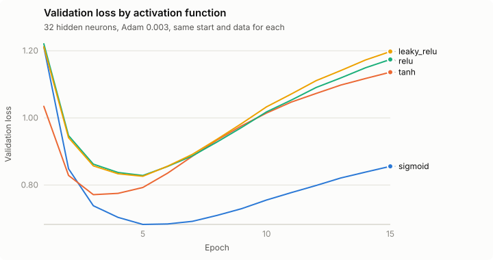
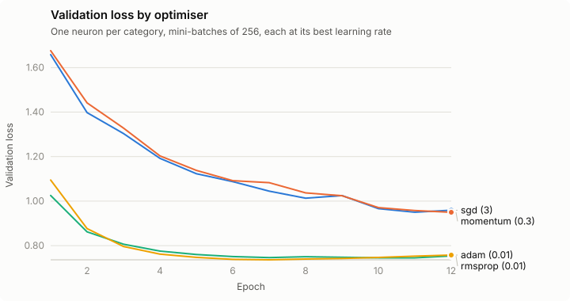
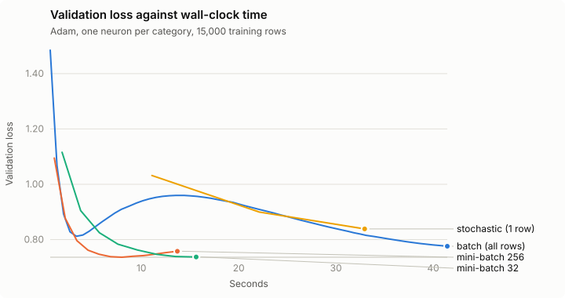
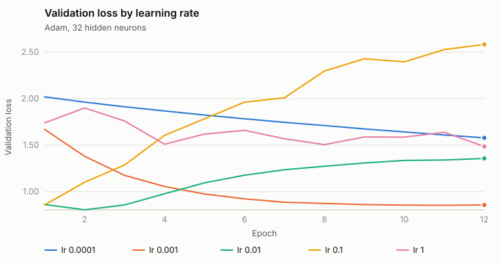
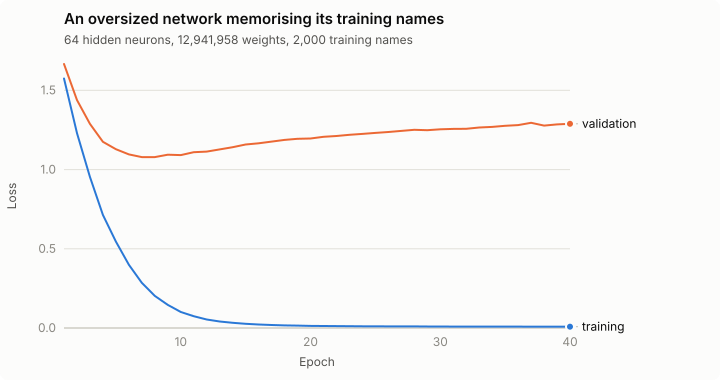
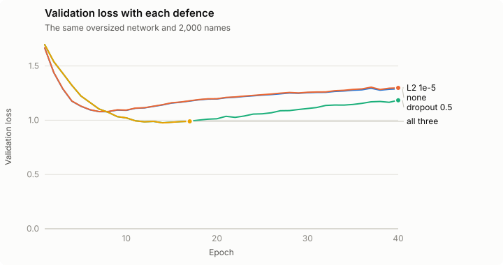
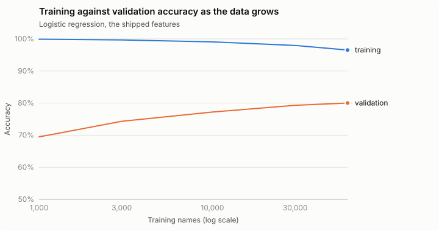

# Category model experiments

Generated by `python -m sugo_category.experiments` on 2026-09-25.
Every number below is computed by that script; `experiments.json` has them all.

**The data.** 59,845 OpenStreetMap shop names to train on, 12,820 to choose settings on
and 12,799 to report the result on, split by name so no shop name is in two of
them; plus the 303 seed phrases of `lexicon.py`. Six categories, production's
catalogue on 2026-09-24. 202,211 n-gram columns, about 70 of them non-zero for a
typical name. The network experiments in sections 3 to 6 use a fixed
15,000-row subsample to keep them to minutes.

Data (c) OpenStreetMap contributors, ODbL 1.0.

## 1. The learning data

Production's store model was trained on 4 categories and
291 seed phrases, and nothing else (`/health` on 2026-09-24:
`real_rows: 0`). It could not name Bakery or Convenience Store at all, though
both are live categories with real pins. The first question is whether more
real names beat a better algorithm. Same classifier throughout (logistic
regression, C = 4.0), scored on 12,820 validation names none of them trained on:

| Trained on | Names | Right | Answers | Right when it answers | Auto-accepted (>= 0.75) | Right when auto |
|---|---|---|---|---|---|---|
| Seed lexicon, 4 categories (live on 2026-09-24) | 12,820 | 60.2% | 53.6% | 80.2% | 39.1% | 83.1% |
| Seed lexicon, all 6 categories | 12,820 | 64.3% | 47.7% | 90.1% | 31.9% | 93.3% |
| Seed lexicon + 59,845 OpenStreetMap names | 12,820 | 80.0% | 85.6% | 86.8% | 70.5% | 92.9% |

The live model can never be right on the 2,328 Bakery and
Convenience Store names, which is part of why it scores 60.2%.
Giving the lexicon all six categories helps (64.3%), but its
303 phrases answer only 47.7% of the names: most shop
names contain no word the lexicon knows. Adding the OpenStreetMap names adds 19.8 points of accuracy
and lifts the share of shops that get a category at all from
53.6% to 85.6%. Nothing later in
this report comes close to that gain: data first, then algorithms.

## 2. One neuron

A single neuron draws one straight line through its inputs. On the logic gates:

| Gate | Solved (starts) | Weights | Bias | Output for 00, 01, 10, 11 |
|---|---|---|---|---|
| AND | 20 of 20 | 12.17, 12.13 | -18.28 | 0.00, 0.00, 0.00, 1.00 |
| OR | 20 of 20 | 12.49, 12.41 | -5.74 | 0.00, 1.00, 1.00, 1.00 |
| XOR | 0 of 20 | 0.0, 0.0 | 0.0 | 0.50, 0.50, 0.50, 0.50 |

AND and OR are one line each, and the neuron finds them from every start. XOR
needs two lines, and the best a single neuron managed was 75% of the four
rows; its outputs sit near the middle because no line separates them.

The shop names turn out to be mostly the easy kind. One neuron answering "is this
a pharmacy?" over the 202,211 n-gram columns gets 98.0% of the
validation names right (finds 91.6% of the pharmacies; 94.0%
of what it calls a pharmacy is one), where always answering "no" would score
86.0%. It took 31.4 s. Words like "drug", "botika" and "pharmacy"
separate with a straight line.

One neuron per category, all six trained together with a softmax, is exactly
the model family this service has always shipped (logistic regression). Trained
here by backpropagation with Adam it scores 78.5% on the validation names.

## 3. Three neurons

Two hidden neurons feeding one output neuron (three in all) is the smallest
network that can solve XOR. It did from 10 of 20 random starts with
sigmoid hidden neurons and 10 of 20 with tanh; the rest settled in a
local minimum. In the first solved run the hidden neurons had taught themselves
OR and AND, and the output neuron combines the two. Nobody told them to.

The same squeeze on the real task: every name passed through 3 hidden neurons
before the 6 category outputs, on the 15,000-row subsample.

| Network | Right | Answers | Right when auto | Log loss | Seconds |
|---|---|---|---|---|---|
| No hidden layer (one neuron per category) | 75.4% | 80.3% | 91.4% | 0.736 | 29.9 |
| 3 hidden neurons | 66.4% | 65.9% | 92.7% | 0.993 | 29.5 |

Three neurons are a bottleneck here: six categories have to be told apart from three numbers, and it costs 9.1 points.

## 4. How big a network

Hidden layers between the n-grams and the six outputs, on the 15,000-row
subsample, each with early stopping on the validation names:

| Hidden layers | Parameters | Right | Answers | Log loss | Best epoch | Seconds |
|---|---|---|---|---|---|---|
| none | 1,213,272 | 75.4% | 80.3% | 0.736 | 7 | 13.2 |
| 3 | 606,660 | 66.4% | 65.9% | 0.993 | 11 | 19.4 |
| 16 | 3,235,494 | 71.5% | 76.3% | 0.851 | 6 | 30.0 |
| 64 | 12,941,958 | 72.8% | 78.4% | 0.808 | 4 | 62.5 |
| 64 x 32 | 12,943,846 | 70.0% | 68.7% | 0.841 | 3 | 52.6 |

No hidden layer did best, at 75.4%.
Hidden layers did not pay for themselves here: text classification over n-grams is close to linear, and every hidden layer adds parameters to overfit with.
The more parameters, the sooner the validation loss stopped improving: best epoch
none 7, 3 11, 16 6, 64 4, 64 x 32 3 (of 25).

## 5. Activation functions

The same one-hidden-layer network with each activation, same start, same data:

| Activation | Best validation loss | At epoch | Right | First/last layer gradient (6 deep) | Seconds |
|---|---|---|---|---|---|
| sigmoid | 0.683 | 5 | 76.5% | 3.0e-03 | 55.6 |
| tanh | 0.771 | 3 | 72.7% | 1.0e+00 | 51.8 |
| relu | 0.828 | 5 | 72.4% | 1.3e+00 | 49.6 |
| leaky_relu | 0.826 | 5 | 72.6% | 1.3e+00 | 51.8 |

Best: sigmoid; worst: relu, 0.146 apart in loss. The last column
is the vanishing-gradient problem measured, not described: in a 6-layer stack of
16 neurons at initialisation, the error signal reaching sigmoid's first layer is
3.0e-03 of what its last layer gets, because every sigmoid layer multiplies
it by at most 0.25. ReLU and leaky ReLU pass it back at full strength wherever a neuron is on.
With one hidden layer, as in the table, a vanishing gradient is not what separates
them; how quickly each fits these names is.

## 6. Gradient descent

**Four update rules**, each given its best of three learning rates, one neuron per
category, mini-batches of 256:

| Optimiser | Learning rate | Best validation loss | Right | Seconds |
|---|---|---|---|---|
| sgd | 3 | 0.950 | 65.3% | 10.9 |
| momentum | 0.3 | 0.950 | 65.8% | 10.8 |
| rmsprop | 0.01 | 0.745 | 75.4% | 11.1 |
| adam | 0.01 | 0.736 | 75.4% | 13.6 |

Best adam, worst sgd, 0.214 apart. Plain SGD's best learning
rate was 300 times Adam's, because TF-IDF gradients are tiny and uneven: a
common n-gram gets a gradient every batch, a rare one almost never. Adam and
RMSProp divide each weight's step by its own recent gradient size, which is the
fix for exactly that; here they finished ahead of SGD and momentum.

**Batch, mini-batch or stochastic.** The same Adam, the same 15,000 rows, taking a
step after every row, every 32, every 256, or only after all of them:

Each batch size got its best of three learning rates.

| Batch | Learning rate | Epochs | Best validation loss | Updates to reach it | Seconds to reach it |
|---|---|---|---|---|---|
| batch (all rows) | 0.1 | 60 | 0.776 | 60 | 41.45 |
| mini-batch 256 | 0.01 | 12 | 0.736 | 413 | 7.98 |
| mini-batch 32 | 0.003 | 8 | 0.737 | 3,752 | 15.63 |
| stochastic (1 row) | 0.001 | 3 | 0.839 | 45,000 | 32.95 |

Lowest loss: mini-batch 256 (0.736). Fastest to its own best: mini-batch 256, in 7.98 s.
Full-batch descent takes one careful step per pass over the data and needs many
passes; one-row stochastic descent takes 15,000 noisy steps per pass and pays
Python's per-step overhead on each of them. Mini-batches sit between the two.

**Learning rate.** Adam with 32 hidden neurons:

| Learning rate | Best validation loss | Final validation loss | Right | Diverged |
|---|---|---|---|---|
| 0.0001 | 1.578 | 1.578 | 37.6% | no |
| 0.001 | 0.853 | 0.856 | 71.0% | no |
| 0.01 | 0.804 | 1.356 | 71.9% | no |
| 0.1 | 0.857 | 2.583 | 72.0% | no |
| 1 | 1.484 | 1.484 | 27.8% | no |

Best 0.01. At 0.0001 it is still far from that when the epochs run out. At 1 every step overshoots:
the loss ends at 1.484.
At 0.1 the best epoch comes early and the loss then climbs back to 2.583: steps that size overfit fast.

## 7. Overfitting

A network far too big for its data: 64 hidden neurons, 12,941,958 weights,
2,000 training names, no defences, trained on past its best.

Training loss falls to 0.008 (99.6% of its own names right) while
validation loss bottoms out at 1.079 in epoch 8 and climbs to
1.289 by epoch 40. Validation accuracy moves far less than the loss
(62.5% at the best epoch, 65.6% at the end): the network
keeps most of its answers but grows ever more certain of the wrong ones, which
is exactly what breaks a 0.75 auto-accept threshold.

The defences, on the same network and names:

| Defence | Validation loss | Right | Epochs run | Best epoch |
|---|---|---|---|---|
| none | 1.289 | 65.6% | 40 | 8 |
| L2 1e-5 | 1.298 | 63.0% | 40 | 7 |
| dropout 0.5 | 1.183 | 67.6% | 40 | 14 |
| early stopping | 1.079 | 62.5% | 11 | 8 |
| all three | 0.976 | 64.8% | 17 | 14 |

Not every defence holds the validation loss below the undefended 1.289:
L2 1e-5 1.298, dropout 0.5 1.183, early stopping 1.079, all three 0.976.

**The cure is more data.** The shipped model's features and classifier, trained on
more and more of the names:

| Training names | Right on its own names | Right on validation | Gap | Seconds |
|---|---|---|---|---|
| 1,000 | 99.9% | 69.5% | 30.4% | 18.1 |
| 3,000 | 99.7% | 74.3% | 25.3% | 30.2 |
| 10,000 | 99.1% | 77.2% | 21.9% | 61.9 |
| 30,000 | 98.0% | 79.3% | 18.6% | 89.4 |
| 60,148 | 96.5% | 80.0% | 16.5% | 170.4 |

The gap between what it has seen and what it has not shrinks from 30.4% to
16.5% as the names grow from 1,000 to 60,148, and validation accuracy
rises from 69.5% to 80.0%. It is still rising at the end, so more names would still help.

## 8. The choice

Everything on the full 60,148 training rows, scored on the validation names. The
networks were run from 3 random starts each; logistic regression has no random start.

| Model | Right (mean) | Spread across starts | Log loss | Answers | Seconds to train |
|---|---|---|---|---|---|
| logistic regression, C = 1 | 80.3% | one run | 0.581 | 77.1% | 161.3 |
| logistic regression, C = 4 | 80.0% | one run | 0.588 | 85.6% | 156.6 |
| logistic regression, C = 16 | 79.7% | one run | 0.658 | 90.5% | 232.2 |
| softmax by backprop (no hidden layer) | 78.5% | 0.1% | 0.641 | 83.5% | 32.3 |
| network, 32 hidden ReLU, dropout 0.5 | 78.2% | 0.2% | 0.645 | 78.3% | 395.9 |

Best: logistic regression, C = 1 at 80.3%. The shipped setting (logistic regression, C = 4) scores
80.0%. Starts of the same network landed up to 0.24% apart, and on
12,820 validation names one standard error of an accuracy near 80.3% is 0.35%; the
larger, 0.35%, is the noise allowance.
The difference, 0.30%, is within it, so the shipped setting stays: a gap that size could come from which names happened to land in validation.

## 9. Calibration and the result

The dispatcher console acts on the confidence number: below 0.55 the pin says
"Category needed", at 0.75 and above the answer is filed without review. Those
cut-offs only mean something if 0.8 is right about 80% of the time. Temperature
scaling fits one number, T, on the validation names so that it is; T = 1.18 here
(the raw model was overconfident, so it is softened). The ranking, and so the accuracy, does not change.

| Confidence | Names (raw) | Right (raw) | Names (T = 1.18) | Right (T = 1.18) |
|---|---|---|---|---|
| 0.00-0.55 | 1843 | 39.3% | 2365 | 42.4% |
| 0.55-0.75 | 1941 | 58.4% | 2124 | 64.9% |
| 0.75-0.90 | 1853 | 78.3% | 2009 | 84.6% |
| 0.90-1.00 | 7183 | 96.7% | 6322 | 97.7% |

**The result**, on 12,799 test names that were never used to train or to choose
anything:

| Model | Right | Answers | Right when it answers | Auto-accepted | Right when auto-accepted |
|---|---|---|---|---|---|
| Live on 2026-09-24 (seed lexicon, 4 categories) | 60.1% | 53.4% | 79.9% | 39.2% | 82.2% |
| Shipped now (+ OpenStreetMap, 6 categories, calibrated) | 80.7% | 81.3% | 88.7% | 65.6% | 94.2% |

Training the shipped store model, test split included, took 509.7 s here.

## 10. Real-life jobs

Production's own labelled jobs on 2026-09-24 (`data/real_jobs.csv`): the category
a dispatcher chose for each shop pinned and each item bought. None of them is in
the training data of either model below, so this is a fair test, if a small one.

**Shops** (9 distinct names):

| Shop | Dispatcher chose | Live model | Shipped model |
|---|---|---|---|
| 7-Eleven Tacurong New Isabela (3453) | Convenience Store | Supermarket & Grocery (0.88) | Convenience Store (0.66) |
| Jollibee Tacurong DT | Fast Food & Restaurant | Fast Food & Restaurant (0.83) | Fast Food & Restaurant (0.89) |
| Julie's Bakeshop Mabini-Dona Alicia, Poblacion, Tacurong | Bakery | Fast Food & Restaurant (0.84) | Bakery (0.87) |
| Kimsan Plaza | Retail & General Merchandise | (none) (0.37) | (none) (0.49) |
| Mercury Drug - Tacurong City Buenaflor | Pharmacy & Health | Pharmacy & Health (0.89) | Pharmacy & Health (0.70) |
| Mercury Drug Tacurong Center | Pharmacy & Health | Pharmacy & Health (0.98) | Pharmacy & Health (0.99) |
| NCCC Supermarket Tacurong City | Supermarket & Grocery | Supermarket & Grocery (0.95) | Supermarket & Grocery (0.98) |
| Rojon pharmacy | Pharmacy & Health | Pharmacy & Health (0.95) | Pharmacy & Health (1.00) |
| Wednesday's Cafe | Fast Food & Restaurant | Fast Food & Restaurant (0.72) | Fast Food & Restaurant (0.67) |

Live: 6 right, 1 silent, 2 wrong. Shipped: 8 right, 1 silent, 0 wrong.

**Items** (26 names). OpenStreetMap lists shops, not what they sell, so the
item model is still the lexicon; the change is that it now knows all six
categories:

Live: 14 right, 7 silent, 5 wrong. With six categories: 18 right, 8 silent,
0 wrong. Missed or left unanswered: Delight, Durex ultra thin, Gin, Robust Extreme, Robust extreme, Rose Pharmancy Lozartan, Super redhorse, coffee.
"Robust Extreme" appears twice on purpose: two dispatchers filed it under two
different categories, so no model can get both right. Items need production's
own history to improve, which grows with every errand and is read at every retrain.

**The Tacurong crawl.** The 121 named places inside the Tacurong box from the
OpenStreetMap extract (`crawler.run`): 87 categorised at 0.75 or above,
34 flagged for review, 5 with no category from either the model or the
mapper's tag. Where the mappers tagged the place and the model answered, the two
agree on 97 of 101.
