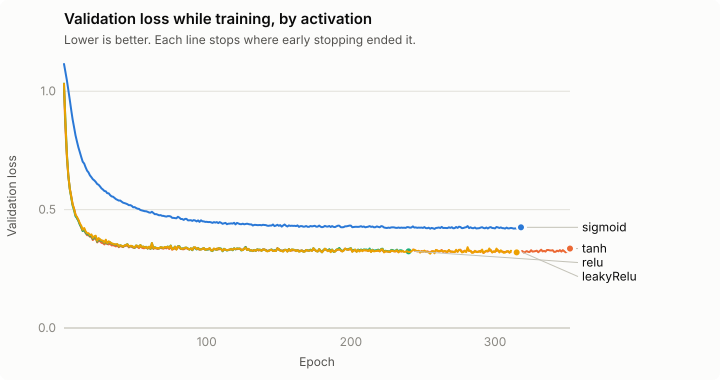
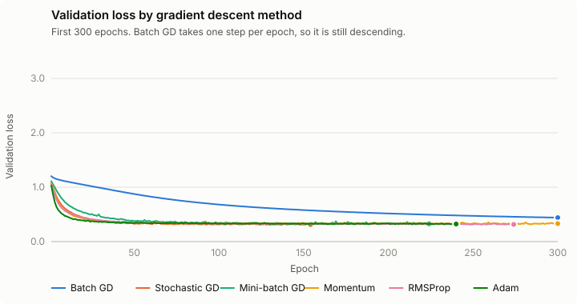
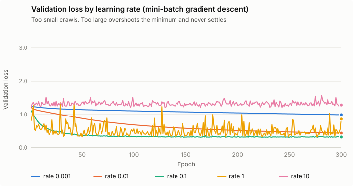
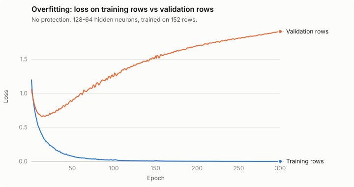
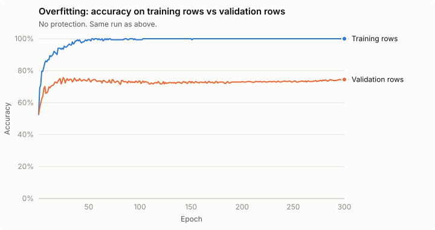
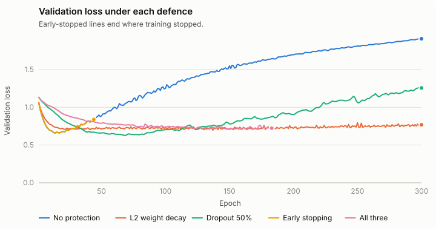

# Experiments: the Conflict Management reason model

Generated by `scripts/exception-reasons/experiments.ts` on 2026-09-24. Every
number below comes from that run. Rows: 1513 training, 325 validation, 322 test,
from dataset.csv (generated scenarios; see README.md for why).

Choices are made on the **validation** rows. Test accuracy is shown for reference
and never used to choose anything. "Suggests (at 0.75)" is the share of rows where
the model is confident enough to show a suggestion; "right when it suggests" is
how often those shown suggestions are correct.

The shipped model: 24 hidden neurons, relu, adam at
0.003, mini-batches of 32, L2 0.001, early stopping after
60 epochs without improvement, gradients clipped at 5. Test: 89.4% accurate,
suggests for 86.0% of rows, right 95.0% of the time when it does.

## 1. One neuron

A neuron adds up its inputs, each multiplied by a weight, adds a bias, and passes
the total through an activation function. With a sigmoid activation it answers
yes (near 1) or no (near 0):

    output = sigmoid(w1 * x1 + w2 * x2 + bias)

That formula draws one straight line through the inputs: yes on one side, no on
the other. Trained here by plain gradient descent on the three classic logic gates:

| Gate | Accuracy | Learned w1, w2, bias | Outputs for 00, 01, 10, 11 | Loss |
|---|---|---|---|---|
| AND | 100.0% | 10.23, 10.23, -15.51 | 0, 0.005, 0.005, 0.993 | 0.004 |
| OR | 100.0% | 11.49, 11.49, -5.28 | 0.005, 0.998, 0.998, 1 | 0.002 |
| XOR | 25.0% | 0, 0, 0 | 0.499, 0.5, 0.5, 0.501 | 0.693 |

AND and OR are learned perfectly: one line separates their yeses from their noes.
**XOR is not**, and never will be by one neuron: its yeses (01, 10) sit on the
diagonal between its noes (00, 11), and no single straight line separates them.
The neuron ends up answering about 0.5 for everything, the least-wrong a straight
line can do. That is why networks have hidden layers.

## 2. Three neurons

Add a hidden layer of two neurons in front of the output neuron: three neurons in
all. Each hidden neuron draws its own line, and the output neuron combines them.
Trained with Adam from 20 different random starts:

| Hidden activation | Learned XOR (out of 20 starts) |
|---|---|
| sigmoid | 11 / 20 |
| tanh | 11 / 20 |

One solved network (sigmoid, start 1). What each neuron outputs for 00, 01, 10, 11:

| Neuron | 00 | 01 | 10 | 11 |
|---|---|---|---|---|
| Hidden 1 | 0.01 | 0.99 | 0.99 | 1 |
| Hidden 2 | 0 | 0.02 | 0.02 | 0.98 |
| Output | 0 | 1 | 1 | 0 |

The hidden neurons have turned the inputs into two new features, typically
something like OR and AND (or NAND). In that new space XOR is separable by one
line, which the output neuron draws. Nobody told the network to do this;
backpropagation found it.

Not every start succeeds. With only two hidden neurons there are flat regions and
dead ends in the loss surface, and gradient descent can settle in one (a local
minimum). Bigger networks have far fewer of these, one reason real networks are
wider than they strictly need to be.

## 3. Network size on the real task

The real job: pick one of 24 reasons from 36 numbers describing an errand. Same
data, same optimiser (Adam), same stopping rule, only the network changes:

| Network | Weights | Train acc. | Val. loss | Val. acc. | Test acc. | Suggests (at 0.75) | Right when it suggests |
|---|---|---|---|---|---|---|---|
| No hidden layer (24 output neurons) | 888 | 89.1% | 0.421 | 88.9% | 89.1% | 59.0% | 94.2% |
| 3 hidden neurons | 207 | 89.1% | 0.418 | 88.3% | 84.8% | 68.3% | 94.1% |
| 8 hidden neurons | 512 | 91.3% | 0.322 | 91.7% | 89.8% | 85.1% | 94.9% |
| 24 hidden neurons | 1488 | 91.5% | 0.320 | 90.8% | 89.4% | 86.0% | 95.0% |
| 64 hidden neurons | 3928 | 91.9% | 0.321 | 91.4% | 89.8% | 87.3% | 94.7% |
| Two layers, 24 and 12 | 1500 | 91.7% | 0.345 | 89.5% | 89.4% | 87.3% | 94.0% |

- **No hidden layer** is 24 single neurons side by side, one per reason, each
  drawing straight lines. Its best guess is right about as often as the bigger
  networks' (89.1% on test), but it is rarely *sure*: it would show a suggestion
  for only 59.0% of rows, against 86.0% with a hidden layer. It cannot
  combine evidence ("a small shop AND the customer paid"), so its probabilities
  stay spread out. With a 0.75 threshold, it would stay silent on 41.0% of errands.
- **3 hidden neurons** is a bottleneck: everything the network knows about an
  errand has to squeeze through 3 numbers before choosing among 24 reasons. Test
  accuracy drops to 84.8%.
- **From 8 neurons up the validation loss is flat** (0.322, 0.320, 0.321), and a second layer is slightly worse (0.345).
  Past that point the extra weights have nothing left to learn from this data,
  only more room to memorise it. 24 has the lowest validation loss by a hair and
  is what ships; 8 would do nearly as well with a third of the weights.

## 4. Activation functions

The activation is what a neuron does with its total before passing it on. Without
one, stacking layers adds nothing: a straight-line function of a straight-line
function is still a straight line.

| Function | Formula | Output range | Slope (what backprop multiplies by) |
|---|---|---|---|
| sigmoid | 1 / (1 + e^-z) | 0 to 1 | at most 0.25 |
| tanh | (e^z - e^-z) / (e^z + e^-z) | -1 to 1 | at most 1 |
| ReLU | max(0, z) | 0 and up | 1 when active, 0 when not |
| leaky ReLU | z if z > 0, else 0.01z | any | 1 or 0.01, never 0 |

Each trained on the real task in the production network (24 hidden):

| Activation | Best epoch | Seconds | Val. loss | Val. acc. | Test acc. | Right when it suggests |
|---|---|---|---|---|---|---|
| sigmoid | 258 | 19.2 | 0.419 | 90.8% | 89.8% | 94.7% |
| tanh | 292 | 22.6 | 0.317 | 91.1% | 89.1% | 94.2% |
| relu | 180 | 14.2 | 0.320 | 90.8% | 89.4% | 95.0% |
| leakyRelu | 255 | 17.2 | 0.314 | 90.5% | 89.1% | 95.0% |

**Why depth hurts sigmoid.** Backpropagation multiplies the error by the
activation's slope at every layer it passes back through. Sigmoid's slope is at
most 0.25, so after several layers almost nothing is left. Measured on a
6-hidden-layer network before any training, the size of the gradient reaching
the first layer compared with the last:

| Activation | First layer | Last layer | First / last |
|---|---|---|---|
| sigmoid | 2.01e-6 | 9.10e-3 | 2.2e-4 |
| tanh | 3.93e-3 | 2.99e-3 | 1.3e+0 |
| relu | 8.67e-3 | 6.99e-3 | 1.2e+0 |
| leakyRelu | 8.50e-3 | 6.89e-3 | 1.2e+0 |

A tiny first-layer gradient means the layer closest to the data barely learns.
This is the vanishing gradient problem, and it is the main reason ReLU replaced
sigmoid inside modern networks. Sigmoid is still the right choice for a single
yes/no output neuron, as in sections 1 and 2.

## 5. Gradient descent

Training is a search for the weights with the lowest loss. Backpropagation gives
the gradient: for every weight, which way is uphill and how steeply. Gradient
descent takes a step the other way:

    weight = weight - learning rate x gradient

The variants differ in how much data each step looks at and how the step is taken.
All six train the same 24-neuron ReLU network:

| Method | Steps to best | Epochs to best | Seconds | Val. loss | Test acc. |
|---|---|---|---|---|---|
| Batch GD (all rows per step) | 2,000 | 2000 | 71.3 | 0.324 | 89.1% |
| Stochastic GD (1 row per step) | 187,612 | 124 | 30.3 | 0.307 | 88.5% |
| Mini-batch GD (32 rows) | 7,872 | 164 | 7.8 | 0.325 | 88.5% |
| Momentum | 12,240 | 255 | 12 | 0.319 | 89.4% |
| RMSProp | 10,272 | 214 | 10.7 | 0.313 | 90.1% |
| Adam | 8,640 | 180 | 10.9 | 0.320 | 89.4% |

- **Batch** gradient descent computes the exact gradient over all
  1513 rows, then takes one careful step. Accurate, but one step per
  pass through the data is slow.
- **Stochastic** takes a step after every single row: fast, noisy steps that
  zig-zag towards the minimum.
- **Mini-batch** is the usual compromise: 32 rows per step, a gradient good
  enough to trust and 48 steps per pass.
- **Momentum** keeps part of the previous step, so it rolls through small bumps
  and speeds up along long, shallow slopes.
- **RMSProp** gives every weight its own step size, smaller for weights whose
  gradient jumps around.
- **Adam** combines momentum and RMSProp. It is what the shipped model uses.

All six end within 0.018 of each other on validation loss: on a problem
this size, every method gets there. What differs is the cost. Batch gradient descent
used all 2,000 epochs it was allowed (71.3 s) and was still improving; stochastic
gradient descent took 187,612 tiny steps (30.3 s). The four mini-batch
methods got there in 7,872 to 12,240 steps, 7.8 to 12 seconds.

**The learning rate** is the size of each step. Plain mini-batch gradient descent
with five different rates:

| Learning rate | Val. loss | Test acc. | Diverged |
|---|---|---|---|
| 0.001 | 0.994 | 63.3% | no |
| 0.01 | 0.447 | 88.8% | no |
| 0.1 | 0.324 | 88.8% | no |
| 1 | 0.333 | 89.1% | no |
| 10 | 1.205 | 32.9% | no |

At 0.001 the network is still far from done after 300 epochs (validation loss 0.994).
At 0.1 it trains smoothly. At 1 it reaches about the same loss but jumps around from
epoch to epoch, a sign the steps are already too big. At 10 every step jumps clean
over the minimum, and the loss bounces around instead of settling: 33.3% accuracy even on the rows
it trains on. Adam and RMSProp are less sensitive to this choice, because they
scale each weight's step by how large its gradients have been.

## 6. Overfitting

A network overfits when it learns the training rows themselves instead of the
pattern behind them: it gets better and better on rows it has seen, and worse on
rows it has not. To make it easy to see, this trains a network much too large
(128 and 64 hidden neurons, 14,552 weights) on a tenth of
the training data (152 rows):

The classic picture. Loss on the training rows keeps falling towards zero. Loss on
the validation rows falls until epoch 14 (0.661), then climbs to
1.908 by the end: the network is memorising, and growing more confident in
answers that do not carry over to new errands.

Accuracy tells the same story more quietly: 100.0% on the rows it trained on,
74.5% on rows it did not. **Overfitting shows up in the loss first**, as
confidence it has not earned. That matters here more than usual, because this
model's output is a confidence, and the 0.75 rule trusts it.

The three standard defences, alone and together. "Val. loss kept" is the
validation loss of the weights each run ends with; lower means its confidence
can be trusted more:

| Defence | Train acc. | Val. acc. | Gap | Val. loss kept | Test acc. |
|---|---|---|---|---|---|
| No protection | 100.0% | 74.5% | 25.5% | 1.908 | 75.5% |
| L2 weight decay | 96.7% | 68.3% | 28.4% | 0.769 | 76.4% |
| Dropout 50% | 99.3% | 77.2% | 22.1% | 1.256 | 78.3% |
| Early stopping | 89.5% | 70.8% | 18.7% | 0.661 | 73.6% |
| All three | 88.2% | 66.8% | 21.4% | 0.704 | 70.5% |

- **L2 weight decay** adds the size of the weights to the loss, so the network
  pays for every large weight and prefers simple explanations.
- **Dropout** switches off a random half of the hidden neurons for each example,
  so no neuron can rely on one particular partner. The network learns several
  overlapping ways to reach each answer.
- **Early stopping** watches the validation loss and keeps the weights from the
  epoch where it was lowest, before the memorising set in.

Every defence holds the validation loss far below the unprotected 1.908. Their
effect on accuracy is mixed on 152 rows. Early stopping even keeps an epoch whose
accuracy is lower than where the unprotected run ended, because it chooses by loss,
which is the right thing to choose by when the product is a confidence. No defence
can make 152 rows teach what 1513 do.

**More data** is the real cure. The production network trained on growing shares
of the training rows:

| Training rows | Train acc. | Val. acc. | Gap | Test acc. |
|---|---|---|---|---|
| 10% (152 rows) | 90.8% | 72.3% | 18.5% | 73.6% |
| 25% (379 rows) | 95.3% | 84.3% | 10.9% | 84.5% |
| 50% (757 rows) | 92.1% | 89.2% | 2.8% | 88.8% |
| 100% (1513 rows) | 91.5% | 90.8% | 0.8% | 89.4% |

The gap between training and validation accuracy shrinks from 18.5% to 0.8% as the
rows grow tenfold. This is also why real cleared errands (section 7) are worth
collecting: each one is a row the model has never seen the like of.

The shipped model uses L2 (0.001) and early stopping (patience 60) on all
1513 training rows. Dropout did not improve its validation loss at this size, so it is off.

## 7. Real-life jobs

The model's job in SUGO is to suggest, in the dispatcher's Conflict Management
queue, why a flagged errand can be cleared (press Tab or **Generate suggestion**).
Below are all 7 exceptions raised on real errands in production, run
through the shipped model exactly as the live API does, beside what the
dispatcher actually wrote when they cleared it.

| Errand | Kind | Amount | Shop | Dispatcher wrote | Model suggests | Confidence | Matches |
|---|---|---|---|---|---|---|---|
| 0b3873b9 | UNVERIFIED_PURCHASE | ₱50 | Kimsan Plaza | (still open) | UNVERIFIED_RECEIPT_LOST | 0.82 | unlabelled |
| 812843d3 | UNVERIFIED_PURCHASE | ₱57 | Julie's Bakeshop Mabini-Dona Alicia | "Unverified purhcase because it has nor receipt." | UNVERIFIED_SMALL_SHOP | 0.85 | yes |
| fb2b0b0a | CASH_VARIANCE | ₱100 | - | "The customer paid a balance in cash" | CASH_OVER_TO_RETURN | 0.88 | unlabelled |
| fb2b0b0a | UNVERIFIED_PURCHASE | ₱50 | Julie's Bakeshop Mabini-Dona Alicia | "the customer paid in cash" | (no suggestion) | 0.57 | no suggestion |
| 01a924d8 | UNVERIFIED_PURCHASE | ₱5,688 | Kimsan Plaza | "Unverified purchase because it has no receipt. This is pass and verified by me." | UNVERIFIED_PAID_IN_FULL | 0.77 | unlabelled |
| 01a924d8 | UNVERIFIED_PURCHASE | ₱500 | Mercury Drug - Tacurong City Buenaflor | "Unverified purchase because it has no receipt. This is pass and verified by me." | UNVERIFIED_PAID_IN_FULL | 0.85 | unlabelled |
| 01a924d8 | UNVERIFIED_PURCHASE | ₱2,000 | Kimsan Plaza | "Unverified purchase because it has no receipt. This is pass and verified by me." | UNVERIFIED_PAID_IN_FULL | 0.83 | unlabelled |

A row is labelled only where the dispatcher's words clearly name one of the 24
reasons (notes in real-jobs.csv). 2 of 7 can be. Of those, the model matches
1, declines to suggest on 1, and gets 0 wrong. That is far too few to measure
accuracy on, and it is reported as counts, not as a percentage.

What the real jobs do show:

- Dispatchers often write who decided rather than why ("verified by me"). A
  suggestion gives the record a reason someone can check later.
- A real cash over-collection turned out to be a customer paying a balance in
  cash. None of the 5 cash reasons covers that, which makes it the first
  candidate for a 25th reason.
- On that cash over-collection the model was 88% sure of "the excess goes back
  to the customer", which is not what happened. Its confidence says which of its
  24 reasons fits best; it cannot say that none of them fits. The 0.75 rule
  catches doubt between reasons, not a reason missing from the list. The
  dispatcher still reads and edits every suggestion before it is recorded.
- On the bakeshop purchase in the same errand the dispatcher wrote "the customer
  paid in cash"; the model was only 57% sure and suggested nothing. That is the
  threshold doing its job: the evidence pointed two ways, and it stayed quiet.

Every real errand cleared from now on can be exported with
`exportRealJobs.ts`, labelled, and added to the training data. Real rows are
worth more than generated ones, because they carry the reasons dispatchers
actually use.

## 8. Choosing the shipped settings

Sections 4 and 5 each changed one thing at a time from a single random start. A
single start is itself a source of variation: the same settings from a different
starting point land somewhere slightly different. So the leading activations and
optimisers were crossed and each pair trained from 3 starts:

| Activation | Optimiser | Val. loss, each start | Mean | Spread (std. dev.) |
|---|---|---|---|---|
| leakyRelu | rmsprop | 0.311, 0.319, 0.313 | 0.315 | 0.004 |
| relu | rmsprop | 0.313, 0.319, 0.313 | 0.315 | 0.004 |
| relu (shipped) | adam | 0.320, 0.312, 0.315 | 0.316 | 0.004 |
| leakyRelu | adam | 0.314, 0.322, 0.314 | 0.317 | 0.005 |
| tanh | rmsprop | 0.321, 0.321, 0.315 | 0.319 | 0.003 |
| tanh | adam | 0.317, 0.324, 0.320 | 0.320 | 0.003 |

The best pair (leakyRelu with rmsprop) beats the shipped one by
0.001. The typical spread between starts of the same pair is 0.004.
The difference is smaller than the noise, so it is not a real improvement, and the
shipped settings stay. Switching would be tuning to luck. The model's accuracy is
limited by the data, where some reasons genuinely cannot be told apart, not by
these settings.
